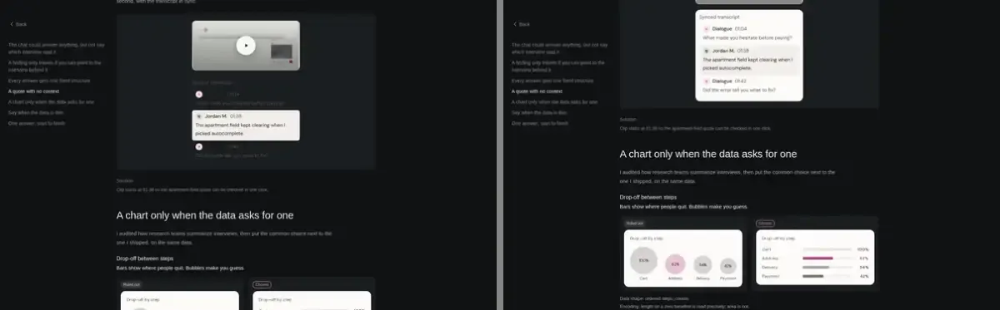
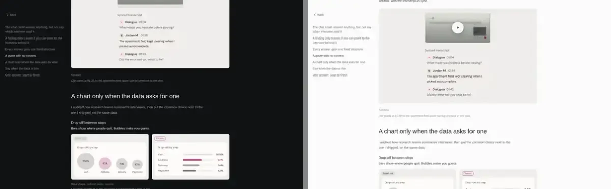
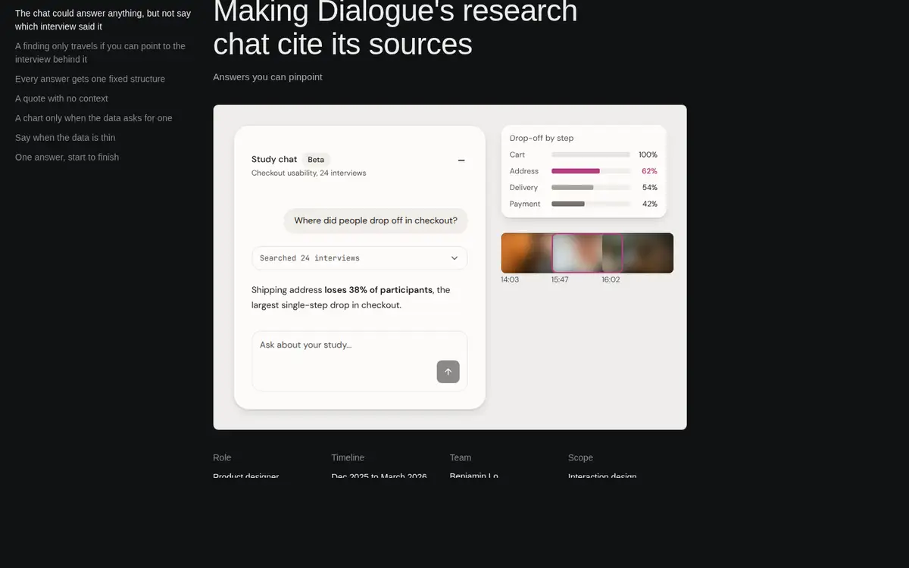

# Dialogue iterations

Distinct rounds only. No per-patch entries. Newest first. Previews are behind Vercel auth. Each URL is the deployment of the commit named in its entry, or of the tip of the push that carried it where noted.

## 183a03d, Oct 22 (r10)
- Changed: transcript on a light card in the quote frame, lightbox safe area, opaque backdrop and hidden contents list, lightbox off at phone width, hero funnel at natural row spacing, BruinLease caption em dash normalised in code.
- Why: r10 audit (dark transcript 1.04:1, lightbox overlap, stretched funnel rows); DLG-07, DLG-15, STD-02.
- Preview: https://portfolio-fj7d2xfn2-mudits-projects-d560e6b3.vercel.app
- Image:  before (r9) left, after right.

## a3ce008, Oct 22 (r9, restore plus lightbox)
- Changed: quote player restored from 657337d with a still-aspect frame and blur box, hero thumbs 3 x 120px, figure well tokens in both themes, library specimens per brief, figure lightbox.
- Why: r9 audit, DLG-17 (Misses M5), DLG-13, DLG-15, DLG-18, DLG-19.
- Preview: https://portfolio-j0swh7ms0-mudits-projects-d560e6b3.vercel.app (tip 03b843b, includes a3ce008)
- Image:  before left, after right.

## 826bc80, Oct 22 (v2 build)
- Changed: straight hero, restored-style quote player, chart library, low-coverage compare, #EEEDEB wells, single-line search status.
- Why: dialogue-v2 brief, DLG-14 to DLG-20, DLG-26.
- Preview: https://portfolio-n6p0w6bow-mudits-projects-d560e6b3.vercel.app (tip 9f220ec, includes 826bc80)
- Image:  after only, no before captured.
