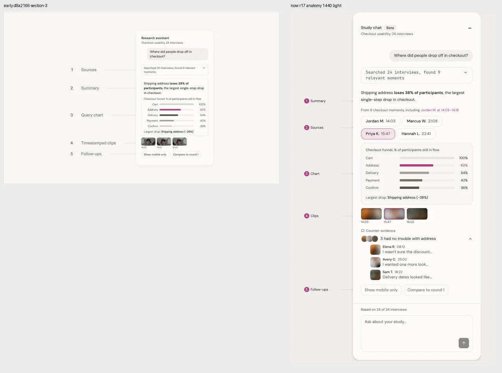
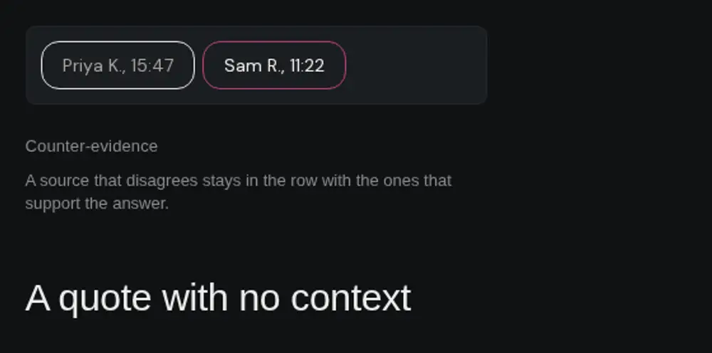
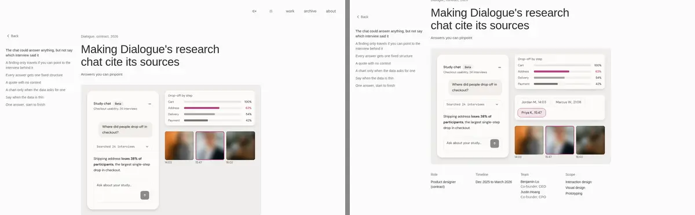

# Dialogue iterations

Distinct rounds only. No per-patch entries. Newest first. Previews are behind Vercel auth. Each URL is the deployment of the commit named in its entry, or of the tip of the push that carried it where noted.

## Round H, Oct 23 2026 (hero answer with counter-evidence, no cut-off charts, mobile evidence rows)
- Changed: PR #120 merged first (moment charts shrink at 390). The icon rail came out of the two query-answer moments. The hero is now one full-width query-answer moment: the checkout question answered with summary, sources and the five-step funnel on the supporting side, and the 18/6 coverage split, the counter-evidence block and the thin mobile slice (4 of 24) alongside it, then a clip and follow-ups, real study data only. On mobile the source chips run in one sideways-scrolling row, the search step's found label is shortened to "moments" and its padding and type tighten so the line wraps to at most two lines, and counter-evidence quotes wrap instead of ellipsising. The comparison trio stacks at 940px and below (chosen first) because at 768 the third panel's text clipped at the frame edge.
- Why: Mudit's round H feedback on round G. Validated locally at 1440, 1024, 768, 390 and 360 in light and dark; no chart, value or label cut off.
- Preview: none (local validation only, per brief)

## Round G, Oct 23 2026 (story restructure and query-answer moments)
- Changed: the story is rebuilt on a 7-move plan, 14 claim headings. The opening splits into what Dialogue is, the problem, why it was hard, and a first-person role heading. A lead line after the hero points at the final answer and names the hidden problem, a confident chart over thin evidence. Why-it-matters carries the trust counts as visible placeholders where Mudit has not supplied them, and counter-evidence gets its own section with the real counter-evidence block. The comparison is told as a sequence (paragraphs, quote list, structured answer) with one prioritised line per option. Clips and follow-ups each gain a ruled-out unit. Thin data is the climax: the 4-of-24 rule, the 18-of-24 case rebuilt as a full query-and-answer moment, and visible placeholders for where the cutoff sits and what would move it. "One answer, start to finish" is renamed to a claim about follow-ups keeping their evidence, and the reflection is replaced by two learnings (cut a chart before a source; changed my mind about chart weight). Two new DialogueQueryMoment figures (segment breakdown, coverage) render a real question as Dialogue's answer card with its evidence trail, trail steps marked with BruinLease Phosphor icons. Chart craft raised: library specimens share a height, the inner chart card radius is concentric with the specimen frame, and secondary colors are the exact DS stone-500 and cherry values.
- Why: Mudit's round G brief. Counts and reasons he has not supplied stay as visible [PLACEHOLDER: ...] markers, never invented. No Vercel preview this round, per the brief; validated in a clean local production build at 1440 and 390, light and dark.
- Preview: none (local validation only, per brief)

## Round F, Oct 23 2026 (two copy fixes)
- Changed: the thin data summary now reads "when autofill skipped the apartment field", lowercase, sentence case like the rest of the figure copy. The follow-up drawer now keeps one story for its counts: the search line reads "Searched 24 interviews, found 18 address moments" (QuerySearchStep gained an optional found label), the footer stays "Based on 18 of 24 interviews", and the clips line reads "Clips from 18 interviews at the address step", all agreeing with the coverage figure's 18 of 24.
- Why: Mudit's round F check found a capitalised Autofill mid-sentence and three count lines in the filtered answer that mixed moments and interviews and repeated the parent answer's search line. Verified in a clean local production build with Playwright at 1440 and 390, light and dark.
- Preview: PREVIEW_URL (deployment of the round F commit on review/dialogue-story-f, merged into review/dialogue-canvas)

## Story depth, Oct 23 2026 (round E)
- Changed: five surface-level spots now carry their reasoning. The problem body says where the answers were headed, slides and reports, and what an untraceable claim costs there. The structure body argues the sequence, sources ahead of the chart because the reader should meet the interviews before the shape. The drop-off annotation rows are renamed from spec labels to the decision itself: first reach, why it failed, tradeoff. The thin data body says why the count is the honest unit, a count cannot look like more than it is. The full answer body names the rejected default, a follow-up starting over with a fresh answer, before the drawer behaviour. Five questions the page cannot answer from the repo were flagged to Mudit instead of being written around: why the original chat shipped without sources, where the thin line sits, whether a regenerating follow-up was ever watched, whether a sixth part was cut, and what was tried for the room problem.
- Why: round E judged the story only, as a hiring manager with four minutes. Verified in a clean local production build with Playwright at 1440 and 390, light and dark: all five replacements live, gaps still exactly 48px, cognitive science still appears once, no horizontal overflow.
- Preview: PREVIEW_URL (deployment of the story depth commit on review/dialogue-story-e, merged into review/dialogue-canvas)

## Light check fixes, Oct 23 2026 (step D)
- Changed: the numbers now reconcile. The checkout answer finds 18 relevant moments in the hero, the trio, and the anatomy source line, matching the 18 of 24 interviews behind the address finding in coverage. The full answer follow-up is retargeted from mobile only to the address step only, so it no longer collides with the thin data mobile answer: its footer reads "Based on 18 of 24 interviews", its search step finds 18 moments, and its chart is the checkout funnel with the address step focal. The counter evidence quotes are now about the address step going fine, matching the "3 had no trouble with address" summary. The hero "-38% drop" tooltip is gone, and the drop is stated as 38 points in the summary and the chart note. The lead comparison now shows the user's question, "Where did people drop off in checkout?", in a user bubble above the three options. Compound modifiers are hyphenated again across the prose, the meta line about a second answer on this page is cut, and the hero dates are spelled out in both places, "December 2025 to March 2026".
- Why: Mudit's light check of cbcfd91 found the contradictions between figures. Verified in a clean local production build (server killed first) with Playwright at 1440 and 390, light and dark: no "-38% drop" anywhere, no "found 9", no "Based on 24 of 24" on the filtered answer, gaps still exactly 48px, no horizontal overflow.
- Preview: PREVIEW_URL (deployment of the light check commit on review/dialogue-story-d, merged into review/dialogue-canvas)

## Cold critique fixes, Oct 23 2026 (step 3)
- Changed: the problem section now shows the problem state, the wall of text answer as a captioned figure, instead of only describing it. The counter evidence claim moved from the structure section, whose figure does not show it, into the why it matters body next to the trio panel that does. The reflection closing sentence is rewritten so it parses. The chart section body no longer narrates where coverage sits on the page, the thin data opening sentence is simplified, and the coverage paragraph no longer repeats its caption. The clips caption spells out the card that failed instead of the shorthand "card-failed quote". The drop off tradeoff line names a real cost: bars rank the steps and nothing more, and why people quit still has to come from the clips. At 600px and below the lead comparison stacks with the chosen panel first.
- Why: a cold critique of the story build against STORY-PRINCIPLES.md and AI-TELLS.md, reviewed as a hiring manager would read it. Verified in a clean local production build with Playwright at 1440 and 390, light and dark: all seven section gaps still measure exactly 48px, desktop trio order unchanged, chosen panel first only on phones, no horizontal overflow.
- Preview: PREVIEW_URL (deployment of the cold critique commit on review/dialogue-story-c, merged into review/dialogue-canvas)

## Story build, Oct 23 2026 (story and copy first, then craft fixes)
- Changed: full story and copy rewrite in first person (claim headings in sentence case, a why and its cost per decision, the missing customers admitted in the body, cognitive science used once, in the structure section). Eyebrow now matches the metadata dates and the subtitle says what the work is. Chart library cut to the drop off pair only; groups and change over sessions pairs removed, coverage moved into thin data as its own captioned figure. The repeated anatomy list is cut, the anatomy figure and the hero now carry the standard caption, and the Limit line is replaced by a text only Reflection section, "What I did not solve". The dead outcome margin rule is removed so the section gap keeps one owner. STORY-PRINCIPLES.md and AI-TELLS.md gained the missing tests: cost in the same breath as the win, admit what was not had, count steps and options instead of metrics, "not X but Y" at most once per page.
- Why: Mudit approved the round 1 and round 2 review fixes on Oct 23. Verified in a local production build with Playwright at 1440 and 390, light and dark: every section gap measures exactly 48px, figure left edges sit on the text column at both widths, the pair stacks at 390 with its notes below both charts, and no horizontal overflow. On this base the hero already used the dark well token and the trio line already sat above its figure, so those two fixes needed no code.
- Preview: PREVIEW_URL (deployment of the story build commit on review/dialogue-story-b, merged into review/dialogue-canvas)
## r24, Oct 23 2026 (text chart reverted, library and anatomy fixes)
- Changed: designed charts back in product figures (r23 palette kept), hero hover restored, question bubbles on the lead compare with a bar chart on the chosen card, anatomy zoomed with real-size labels, lightbox fits the viewport, Paper avatar on Dialogue transcript rows, Phosphor pros and cons icons, a busier first draft for the dropoff pair, new chart title treatment, equal-height concentric library frames.
- Why: Mudit's r24 notes, ledger DLG-99 to DLG-113.
- Preview: none, local build only (no [preview] tag)

## r23, Oct 23 2026 (color pass)
- Changed: chart fills limited to stone-500 plus cherry, stacked bars on stone-500 and stone-600 with white labels, 1px stone-200 card border in light mode, product figures show Dialogue's own text chart (dark block and markdown table) instead of designed charts.
- Why: Mudit's r23 color pass, ledger DLG-95 to DLG-98.
- Preview: none, local build only (no [preview] tag)

## r22, Oct 23 2026 (Agentation notes)
- Changed: skip labels centred in their circles, chart library judged by pro and con lists instead of status chips, full answer gets a lead, supporting and quote hierarchy. No chart colors changed.
- Why: Mudit's r22 notes, ledger DLG-92 to DLG-94.
- Preview: none, local build only (no [preview] tag)

## r20, Oct 23 2026 (Agentation notes on 160151d)
- Changed: anatomy callouts scale with the UI and the composer is DS height, interview player rebuilt from the Paper export with a mirrored skip back, chart library pairs now richer first draft versus simplified chosen, dot plot and stacked bar primitives for variety, DS button for Add to my plan.
- Why: Mudit's r20 notes, ledger DLG-86 to DLG-90.
- Preview: none, local build only (no [preview] tag)

## r19, Oct 22 2026 (Agentation notes)
- Changed: lead compare no longer clips and gets a calmer surface (two extension tokens), figures capped at 640px by scaling, chart titles on their own row, chart library near-miss specimens with numbered markers, thin-data "Add to my plan" copies a prompt, ClipCard accent bar removed, hero footer expand icon dropped.
- Why: Mudit's r19 notes, ledger DLG-79 to DLG-85 (his DLG-70 to 78).
- Preview: none, local build only (no [preview] tag)

## r18, Oct 22 2026 (polish)
- Changed: 390 anatomy shows all five parts, hero search step within two lines (chat column +24px, shorter copy at phone width), hero "-38% drop" tooltip back, transcript player black edge to edge, balanced wrap in the amber warning.
- Why: r18 audit of 3585bb6. DLG-70 to DLG-72.
- Preview: PREVIEW_URL (deployment of COMMIT_SHA)

## r17, Oct 22 2026 (restore plus DS conformance)
- Changed: restored trust signals (amber low-signal warning, evidence footer, "Ask this next study"), counter-evidence expander, Paper section-5 transcript and the anatomy search line, inline clip link and footer; hero aside is now quote rows plus the evidence footer; pill format, send button, focus border, chart-title gap and lead comparison type scale per plan.md; styles/dialogue-tokens.css (DS raw, role tokens, extension block) with the product CSS migrated; check:dialogue-tokens.
- Why: Mudit approved the r17 restore plan and the DS conformance audit. DLG-58 to DLG-69.
- Not restored: study view and hero layout (Mudit's follow-up). Lead comparison card keeps no footer.
- Preview: https://portfolio-q4ati66yx-mudits-projects-d560e6b3.vercel.app (deployment of 3585bb6, protected; check:dialogue-preview, check:annotate and check:site-mobile passed against it)
- Image:  early left, now right.

## DLG-57, Oct 22 2026 (Agentation comment box typing)
- Changed: every window or document key listener (ruler mode, lightbox, project popup, quarter picker, bento gallery, motion lab) returns early for editable targets through lib/isEditableTarget, which reads composedPath. The toolbar stops typed characters in the capture phase so other tools' single-letter shortcuts cannot swallow them. check:annotate types the full alphabet, digits and punctuation into the comment box on /dialogue and /.
- Why: Mudit could not type some letters ("c") in the comment box. No site listener reproduces it; the Vercel preview toolbar binds "c" and is the likely source, so the guard is aimed at it. Unverified without a logged-in toolbar session.
- Preview: https://portfolio-dxba7y8op-mudits-projects-d560e6b3.vercel.app (deployment of 99022e7)
- Image: none this round.

## e7cd42c, Oct 22 2026 (Agentation on Dialogue)
- Changed: merged origin/review/agentation (PR #107, 8aa312e), taking its STD-09 over the earlier revert. Every Dialogue figure part (hero, anatomy, library pairs, counter-evidence, thin-data figure, quote player, lightbox) carries data-annotate="dialogue-<figure>/<part>". Kept our CaseStudyLightbox (live children), CaseStudyFigure narrow handling and the BruinLease caption stopgap, with their annotate attributes added.
- Why: Mudit wants Agentation on the Dialogue preview.
- Preview: https://portfolio-mb2mxeofa-mudits-projects-d560e6b3.vercel.app (deployment of 5ebac65, code identical to later script-only commits)
- Image: none this round.

## 40e417f, Oct 22 2026 (DLG-56 critique fixes)
- Changed: chat cards keep their full radius and shadow (16px room under uncropped cards in the shared scale viewport, clip margin at the sides), the empty chart slot is a 123px dashed placeholder at the hero chart height with the line centered in muted ink, the two source chips stay on one row at 390 (10px chip padding, 12px body padding at 600px and below) and wrap only at 360, caption confirmed visible at 390 and 360.
- Why: Mudit's DLG-56 critique of the screenshots. Cropped figures at 390 (hero, anatomy, full answer) still clip by design.
- Preview: https://portfolio-64yzxi9bb-mudits-projects-d560e6b3.vercel.app
- Image: none this round.

## 13b138e, Oct 22 2026 (DLG-56, after r15)
- Changed: the thin-data pair is now one full-width figure on the standard well, with one chat card (question, "2 of 24 interviews" panel, summary, two source chips, the held-back-chart line) and the caption "Thin data. A finding from two interviews must not reach a roadmap as a trend." New section lead, and a pointer under "One answer, start to finish". Chips use the DLG-48 owners. STD-09 was reverted on this branch (a separate agent builds it on review/agentation).
- Why: Mudit approved the replacement (DLG-56, DLG-20).
- Preview: https://portfolio-r010xatx8-mudits-projects-d560e6b3.vercel.app
- Image: none this round.

## 6bb5f1b, Oct 22 2026 (r15)
- Changed: merged origin/main (includes the mobile fixes from PR #106), closing line now reads "Limit: the chat has to hold summary, chart, and clips without feeling crowded." with the DLG-47 spacing kept, and the ledger records Needs Mudit 7 as done and 8 and 9 as declined. The BruinLease caption source is not edited yet.
- Why: Mudit approved my calls Oct 22, DLG-55 and BRL-01. The Sanity edit needs a write token this environment does not have.
- Preview: https://portfolio-1f4bxn31y-mudits-projects-d560e6b3.vercel.app
- Image: none this round.

## 80b31f8, Oct 22 2026 (r14)
- Changed: one owner per timestamp in every figure, one outlined pink Chosen tag, full-width counter-evidence, equal 32px lightbox well padding, 16px overlap on the 390 hero card, library intro trimmed to "Each pair puts the common choice next to mine, on the same data.", problem section figure removed, preview check extended (DLG-48 owners, DLG-52 hero overlap).
- Why: r13 audit and outside review, DLG-48 to DLG-54 and M11.
- Preview: https://portfolio-ow64oer70-mudits-projects-d560e6b3.vercel.app/dialogue (mudits-projects team preview, READY; `npm run check:dialogue-preview` passed against it)
- Image: none this round. The r13 entry's before and after image was removed because its "before" did not show the pre-r13 state.

## a3f5f0a, Oct 22 (r13)
- Changed: lightbox Close with fixed light-on-dark styling, quieter neutral pill outline in dark, hero sources grid filling its card, section spacing above the closing Outcome line, preview check extended (open-lightbox sweep, dark Close clicks, no-trigger assert, SELFTEST).
- Why: r13 audit, DLG-44 to DLG-47 and M10.
- Preview: https://portfolio-my31xb62i-mudits-projects-d560e6b3.vercel.app/dialogue (mudits-projects team preview, the only team this account can reach; READY)

## 226dd8d, Oct 22 (r12)
- Changed: lightbox portaled to document.body with Close anchored to the dialog corner (same 600px cutoff for BruinLease), theme-aware counter-evidence pills, hero sources as a 2x2, one caption token, 390 fixed-structure figure fits, preview check script.
- Why: r12 audit, DLG-31 and DLG-39 to DLG-43.
- Preview: https://portfolio-392868ixu-mudits-projects-d560e6b3.vercel.app (deployment of 226dd8d, protected; `npm run check:dialogue-preview` passed against it)
- Image:  dark counter-evidence after the fix; no before image because the audit preview of 695eaa3 could not be reopened.

## 56f4d73, Oct 22 (r11)
- Changed: theme-aware ink on figure wells, hero sources card with trimmed chat gaps, caption contrast, 600px lightbox cutoff, audit screenshots removed; the lightbox-above-header fix did not take on the preview (Close still hit the nav, fixed in r12).
- Why: r11 audit, DLG-31 to DLG-38.
- Preview: https://portfolio-ehe50danl-mudits-projects-d560e6b3.vercel.app (deployment of ea29e31, the tip that carried 56f4d73; code identical to later log-only commits)
- Image:  hero before (r10) left, after right.

## 183a03d, Oct 22 (r10)
- Changed: transcript on a light card in the quote frame, lightbox safe area, opaque backdrop and hidden contents list, lightbox off at phone width, hero funnel at natural row spacing, BruinLease caption em dash normalised in code.
- Why: r10 audit (dark transcript 1.04:1, lightbox overlap, stretched funnel rows); DLG-07, DLG-15, STD-02.
- Preview: https://portfolio-fj7d2xfn2-mudits-projects-d560e6b3.vercel.app
- Image:  before (r9) left, after right.

## a3ce008, Oct 22 (r9, restore plus lightbox)
- Changed: quote player restored from 657337d with a still-aspect frame and blur box, hero thumbs 3 x 120px, figure well tokens in both themes, library specimens per brief, figure lightbox.
- Why: r9 audit, DLG-17 (Misses M5), DLG-13, DLG-15, DLG-18, DLG-19.
- Preview: https://portfolio-j0swh7ms0-mudits-projects-d560e6b3.vercel.app (tip 03b843b, includes a3ce008)
- Image:  before left, after right.

## 826bc80, Oct 22 (v2 build)
- Changed: straight hero, restored-style quote player, chart library, low-coverage compare, #EEEDEB wells, single-line search status.
- Why: dialogue-v2 brief, DLG-14 to DLG-20, DLG-26.
- Preview: https://portfolio-n6p0w6bow-mudits-projects-d560e6b3.vercel.app (tip 9f220ec, includes 826bc80)
- Image:  after only, no before captured.
